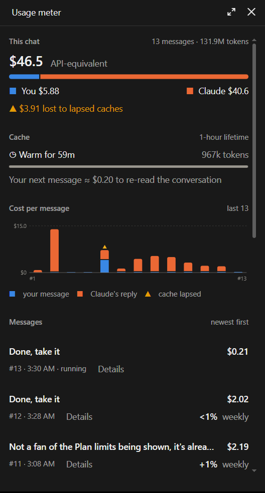

# Claude usage meter

See how much usage **every message** uses in Claude Code: your message, and Claude's reply. It also shows the prompt cache, so you can see why coming back to an old conversation can eat a chunk of your limits, before you send.

Claude Code's own `/usage` shows session totals, and the desktop app shows context and plan-limit rings. Neither breaks usage down by message. This does: each message's row shows what it cost in API-equivalent dollars and its share of your weekly limit, flags a lapsed cache, and opens to the tokens behind it.

Two pieces:

- **A mod for Claude Code** (desktop app and terminal): a pane beside the chat with one row per message, a one-line band above the prompt, a usage line under each reply, and a `/usage-meter` command.
- **A command-line report** over the conversations already on your computer, as a terminal table or an HTML page.

<p align="center"></p>

## Install

At the prompt of a Claude Code terminal session:

```
/plugin install usage-meter --marketplace NessDan/claude-token-usage
```

Answer `y` to add the marketplace, then press Enter for the user scope, which loads the meter in every session on your computer. It's active right away in that session.

From a shell:

```bash
claude plugin install usage-meter --marketplace NessDan/claude-token-usage
```

In the desktop app, where `/plugin` doesn't run: click **+** next to the prompt box, then **Plugins**, **Add marketplace** with `NessDan/claude-token-usage`, then **Add plugin**. A chat that was already open picks the meter up with `/reload-plugins`; new chats load it on their own.

Built and tested on Claude Code 2.1.321. The one-line install needs 2.1.275 or later. The command-line report needs Node 22.18 or later.

## What it shows

**The pane** opens beside the chat (type `/usage-meter`). From the top:

- **This chat**: the total, split into your messages and Claude's replies, and what lapsed caches cost.
- **Weekly limit**: this chat's share of your weekly limit since the last reset, beside how much your account has used in all and when it resets. Once the meter can estimate it, the chat's share is marked ≈ and drawn as its own part of the bar. Until then the section shows how far the weekly reading moved while this chat worked, which is rough: other chats running at the same time count too.
- **Cache**: how long the conversation stays cached, and what your next message costs to re-read it, or, once it has expired, to write it all again.
- **Cost per message**: the last 40 messages, with ▲ where a cache had lapsed. In the desktop app, hovering a bar shows its message's number, cost and first words beside the section's title, and a ↓ under the bar; clicking ↓ scrolls the pane to that message, which stays highlighted for a few seconds.
- **Messages**, newest first:

```
ok now build it                                       $5.29
#12 · 8:41 PM   Details                      ≈0.64% weekly
▲ Cache had lapsed, after 2h 13m away: +$1.84
```

Each message shows what it cost and its share of your weekly limit, side by side. Once the meter has calibrated it, the share is an estimate marked ≈ (see [Reading the numbers](#reading-the-numbers)). Until then it's how far Claude Code's own weekly reading moved while the message ran: "+1%", or "<1%" when the reading didn't move. A third line appears only when a cache had lapsed. **Details** opens the rest: what your message cost against Claude's reply, why the cache lapsed and how much it wrote again, the measured plan change, and each request. A row that a background task or another session started is labelled with what started it. "About these numbers" at the bottom explains the figures.

**The band above the prompt** depends on what's happening:

- while Claude works: what this message has used so far;
- while the cache is warm: how long it has left, and what your next message costs to re-read the conversation;
- once it has lapsed: what your next message will cost to write it all again.

**A line under each reply**, display only (Claude never sees it):

```
Usage: you $0.31 (read 236k from cache) · Claude $1.10 (14 requests · 18k written) · ≈0.17% of weekly · Plan (all your sessions): Weekly +1%
```

**A toast** when a turn had to re-write the conversation because its cache had lapsed, and that cost $0.25 or more.

| Command | What it does |
| --- | --- |
| `/usage-meter` | opens the pane, and shows the band if it was hidden |
| `/usage-meter hide`, `/usage-meter show` | hides or shows the band in that chat (the band's Hide button does the same and says how to get it back) |
| `/usage-meter notes-off`, `/usage-meter notes-on` | turns the line under each reply off or on |

## Why one message can cost so much more than another

Every message re-sends the whole conversation to Claude.

- Claude keeps a recently used conversation in a **prompt cache**. While it's there, re-reading it is cheap: on Opus 5.5, 5% of the normal input price.
- The cache expires after a while with no requests. On a Claude subscription, within its usage limits, that's **1 hour** for the main conversation. It's 5 minutes for subagents and workflows, and 5 minutes once you're drawing on extra usage.
- The first message after it expires has to **write the whole conversation into the cache again**, at 2× the input price.

So the same message can cost **20× to 80× more** than it would have an hour earlier, depending on the model. The same thing happens mid-turn: answer a question or permission prompt after the cache has lapsed, and the next request re-writes the conversation. A background task or workflow that finishes after the cache has lapsed wakes Claude, and that turn pays it too.

**Idle compaction** helps with big conversations. When one has reached 200,000 tokens and you've been away about an hour, Claude Code summarizes it while the cache is still warm (setting `idleCompaction`, on by default; your computer has to stay awake). Running `/compact` yourself before you step away does the same for any conversation. Once the cache has lapsed, `/compact` has to reprocess the whole history uncached, so it saves much less.

[docs/HOW-USAGE-WORKS.md](docs/HOW-USAGE-WORKS.md) explains usage, caching and compaction in detail, with sources.

## Reading the numbers

- **You** is what your message cost before Claude did anything: reading the whole conversation plus your new text. That's cheap when the cache is warm, and expensive when it has lapsed.
- **Claude** is everything Claude did to answer: thinking and writing, each tool round trip (every one re-sends the conversation), subagents and workflow agents, and the advisor.
- **Dollars** are Anthropic's API list prices applied to the token counts the API reported. A subscription doesn't charge them; they're the best common scale for comparing messages, because Anthropic doesn't publish how tokens map to plan limits. A dollar figure marked ≈ includes output that had to be estimated.
- **The weekly share** ("+1% weekly"), until the estimate below is ready, is how far Claude Code's own reading of your weekly limit moved while the message ran. It's account-wide, so anything else using your account at the time counts too, and it's coarse: the reading often moves in whole-percent steps, so a short message shows "<1%". It's only recorded while the mod is loaded. Once the estimate takes its place, this measured change stays in the message's **Details**.
- **The estimated weekly share** ("≈0.17% weekly") is the message's dollars times a rate the meter calibrates from your own weekly readings. Each time the weekly reading steps up, the meter notes when. Between two steps the limit moved by exactly their difference, and the meter knows what was spent in between. "About these numbers" in the pane says what the rate is based on, for example "1% of your weekly limit ≈ $8.30 of use here, from 9 points over $75.0 spent by 5 chats on this computer". The **Weekly limit** section adds up this chat's dollars since the last weekly reset the same way.
  - **Several chats at once don't throw it off.** The readings are account-wide, so every chat running the meter shares the dollars it spent, by the minute, and the readings it saw. The rate divides the points by what all of them spent. A chat dividing by its own spend alone, with four others working, would put every share about five times too high.
  - **It waits for data.** Until 3 points have been measured between closely timed steps of the weekly reading while chats here were working, a message shows the measured change instead. A stretch never spans a weekly reset or an hour in which no chat here was working, so use elsewhere while this computer was idle stays out.
  - **What makes it run high:** use the meter can't see while chats here are working. That's claude.ai in a browser, the phone, another computer, or a chat on this computer that hasn't loaded this version of the meter. That use moves the weekly reading without adding to the dollars. After updating the meter, run `/reload-plugins` in every open chat.
  - It assumes your plan counts usage in proportion to API prices, which Anthropic doesn't publish. A mix of models or caching unlike the calibration's can shift it. It covers the overall weekly limit, not the separate Fable one.
- **Cache states** for each message, as the report's Cache column names them (the pane says the same in words, under **Details**):

  | State | Meaning |
  | --- | --- |
  | warm | the conversation came from the cache |
  | ▲ cold | the cache didn't serve the conversation: idle too long, the model changed, or something early in the conversation changed |
  | ▲ partial | part of the conversation had to be written again |
  | reset | the context was rebuilt on purpose: after a compaction, or a much shorter conversation (a rewind, cleared tool results) |
  | first | the session's first message |

## The command-line report

Clone this repository, then from its folder:

```bash
npm run report
```

That shows your latest session. The other forms:

```bash
npm run report -- --all
```

```bash
npm run report -- <session-id> --html report.html
```

```bash
npm run stats
```

`--all` lists every session, most lost to lapsed caches first. `--html` writes a page with a chart and the full table. `npm run stats` sums your whole history: what was lost to lapsed caches, on your messages, mid-turn and inside agents, counting resumed and forked sessions once. `npm run report -- --help` lists every option. The report only reads the transcripts in `~/.claude/projects`; it changes nothing.

## Limits

- **Compaction's summary request isn't written to the transcript.** The mod records it live and shows it as its own row; the command-line report can't see it.
- **Older agent transcripts** (Claude Code 2.1.219 to 2.1.293) recorded only part of each agent request's output. Those outputs are estimated from the text the agent wrote and marked ≈. Thinking isn't in the file, so the estimate runs low.
- **Per-model weekly limits** (a separate Fable weekly bucket, say) show in Claude Code's `/usage`, but Claude Code 2.1.321 doesn't pass them to plugins. So the meter shows only the 5-hour and overall weekly windows, and estimates shares of the overall weekly one.
- **The weekly share is an estimate.** It runs high while something the meter can't see uses your account at the same time as the chats here (see [Reading the numbers](#reading-the-numbers)). It's also only as good as its assumption that your plan counts usage in proportion to API prices.
- **Prices are list prices as of November 2026** ([plugins/usage-meter/lib/pricing.ts](plugins/usage-meter/lib/pricing.ts)). A model missing from the table is priced as Opus 5.5, and its name says so wherever it's shown.
- **Very large sessions need Node.** The mod reads transcripts over 4 MB through Node.

## Development

- [plugins/usage-meter/](plugins/usage-meter/) holds the plugin: `hooks/register.tsx` (the mod), `lib/` (the shared core), `cli/` (the report), `scripts/summarize.ts` (the mod's helper for large transcripts) and `tests/`.
- [test/core.test.ts](test/core.test.ts) holds the core's unit tests: `npm test`. The mod's own tests run in Claude Code's test kit: `claude plugin test plugins/usage-meter`. `claude plugin validate .` checks the marketplace file, the manifest and the hooks module.
- To run the meter from your clone, add the clone as a marketplace and install from it: Claude Code then reads the plugin straight from the folder, and `/reload-plugins` picks up an edit.

  ```bash
  claude plugin marketplace add <path to your clone>
  ```

  ```bash
  claude plugin install usage-meter@claude-token-usage
  ```

- [docs/DESIGN.md](docs/DESIGN.md) records the decisions made while building this: how a message's usage is split, how cold caches are judged, how transcripts are read.
- [scripts/history-stats.ts](scripts/history-stats.ts) is `npm run stats`. [scripts/sync-dev-mod.mjs](scripts/sync-dev-mod.mjs) copies the plugin into one session's mods folder while developing a change there.

## License

MIT. See [LICENSE](LICENSE).
